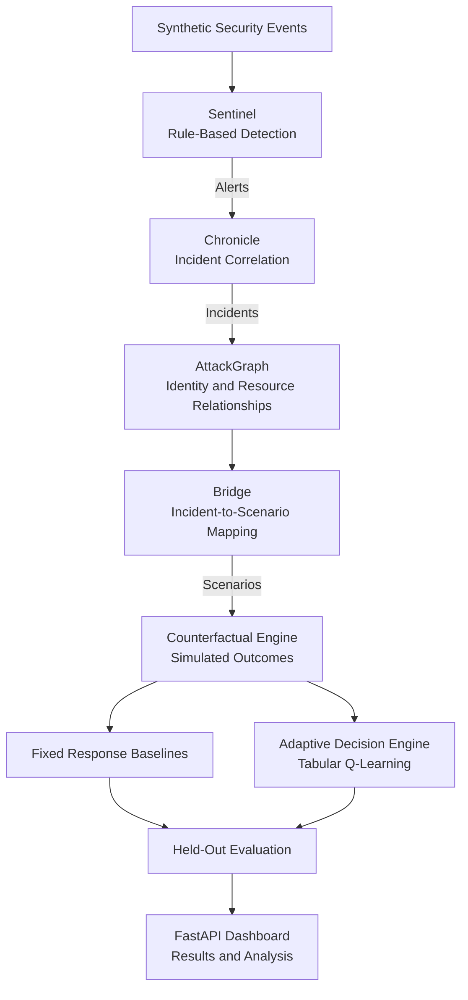

# AEGIS-D
### Adaptive Experimental Graph Intelligence for Security — D

**An experimental cloud security research platform exploring adaptive incident response using reinforcement learning, attack graphs, and controlled simulation.**

Can an agent learn to select incident-response strategies that reduce security risk while minimising disruption to legitimate services — and outperform fixed response rules on previously unseen incidents?

AEGIS-D investigates this question through a reproducible, simulation-based evaluation framework.

> **Research prototype:** AEGIS-D operates entirely on synthetic security events and simulated infrastructure relationships. It does not connect to cloud providers, execute containment actions, or demonstrate real-world response effectiveness.

---

## Research Results

Across **20 random seeds**, a tabular Q-learning agent improved on the best fixed-response baseline by:

### 8.94% ± 1.44%

The improvement was positive in every run on held-out scenarios.

However, the benefit is **regime-dependent**. When availability loss is weighted at or above risk reduction, the optimal fixed action — privilege revocation — matches the learned policy, eliminating the improvement.

This identifies an operating window in which adaptive response adds value and conditions under which it does not.

See [`RESULTS.md`](RESULTS.md) for the full methodology, weight sweeps, evaluation protocol, and boundary characterisation.

---

## Architecture



Every layer is implemented, tested, and integrated. The FastAPI application exposes the research pipeline through a web dashboard.

### Core pipeline

1. **Sentinel:** Detects suspicious activity using deterministic security rules.
2. **Chronicle:** Correlates detection alerts into security incidents.
3. **AttackGraph:** Represents assumed relationships between identities, roles, services, and resources.
4. **Scenario Bridge:** Converts incident information into simulation scenarios.
5. **Counterfactual Engine:** Estimates response outcomes using a documented simulation model.
6. **Decision Engine:** Compares fixed-response strategies against a tabular Q-learning policy.
7. **Held-Out Evaluation:** Evaluates policies on the same unseen scenarios for a controlled comparison.
8. **Dashboard:** Presents incidents, attack graphs, policy comparisons, and experiment results.

---

## What Is Real vs. Simulated?

| Component | Implementation status |
|---|---|
| Security event generation | Synthetic, CloudTrail-flavoured events |
| Threat detection | Deterministic rules with MITRE technique mapping |
| Incident correlation | Implemented logic operating on synthetic data |
| Attack graph | NetworkX graph of assumed access relationships |
| Response outcome model | Simulation based on documented assumptions |
| Reinforcement learning | Tabular Q-learning: 9 states, 3 actions, one-step decisions |
| Evaluation | Held-out experimental protocol with simulated outcomes |
| Cloud integration | Not implemented |

All assumptions are documented in the code and research results. No claims of real-world effectiveness are made.

---

## Features

- Synthetic cloud-security event generation
- Rule-based threat detection and MITRE technique mapping
- Security incident correlation and investigation
- Graph-based representation of identities and access relationships
- Simulated incident-response outcome modelling
- Reinforcement learning for adaptive response selection
- Comparison against three fixed-response baselines
- Held-out evaluation across multiple random seeds
- Sensitivity analysis and response-cost weight sweeps
- Boundary characterisation to identify when adaptive response provides no advantage
- Interactive dashboard for exploring results
- Automated test suite with 155 tests

---

## Dashboard

The dashboard provides five main views:

| View | Description |
|---|---|
| **Overview** | Pipeline KPIs, attack-type distribution, and training cost curve |
| **Attack Graph** | Interactive network of identities, roles, services, and resources |
| **Investigation** | Security incidents, event timelines, and MITRE technique tags |
| **Response Policy** | Learned policy compared with three fixed baselines on held-out data |
| **Saved Runs** | Experiment history, configurations, and recorded results |

---

## Technology Stack

| Component | Technology |
|---|---|
| Language | Python 3.12 |
| API backend | FastAPI, Uvicorn |
| Graph analysis | NetworkX |
| Reinforcement learning | Tabular Q-learning |
| Frontend | HTML, CSS, JavaScript |
| Visualisation | vis-network, Chart.js |
| Testing | pytest |
| Persistence | JSON files |
| Research evaluation | Reproducible experiments, held-out scenarios, seed and weight sweeps |

---

## Quick Start

### Prerequisites

- Python 3.12
- Git
- A modern web browser

### 1. Clone the repository

```powershell
git clone https://github.com/Naivete-1/AEGIS-D.git
cd AEGIS-D
```

### 2. Create and activate a virtual environment

```powershell
python -m venv .venv
.\.venv\Scripts\Activate.ps1
```

### 3. Install dependencies

```powershell
python -m pip install --upgrade pip
pip install -e ".[dev]"
```

### 4. Run the test suite

```powershell
python -m pytest -v
```

### 5. Run a held-out experiment

```powershell
python scripts/run_experiment.py
```

### 6. Run the analysis

```powershell
python scripts/analyse.py
```

### 7. Run boundary characterisation

```powershell
python scripts/boundary_sweep.py
```

### 8. Launch the dashboard

```powershell
python -m uvicorn aegis.api.main:app --reload
```

Open [http://127.0.0.1:8000/](http://127.0.0.1:8000/) in your browser.

**Note:** These commands reflect the current project structure. If your local package configuration uses a different import path or installation setup, follow the actual files in your repository.

---

## Repository Structure

```text
AEGIS-D/
├── src/
│   └── aegis/
│       ├── events/        # Synthetic events and schemas
│       ├── sentinel/      # Rule-based threat detection
│       ├── chronicle/     # Incident correlation and scenario bridge
│       ├── attackgraph/   # Access relationship graphs
│       ├── simulator/     # Response outcome simulation
│       ├── agents/        # Q-learning agent and fixed baselines
│       ├── experiment/    # Experiment execution and analysis
│       ├── scenarios/     # Synthetic scenario generation
│       └── api/           # FastAPI application
├── frontend/              # HTML, CSS, and JavaScript dashboard
├── scripts/               # Experiment and analysis entry points
├── tests/                 # Automated test suite
├── results/               # Generated experiment outputs (gitignored)
├── RESULTS.md             # Research methodology and findings
└── README.md
```

---

## Research Limitations

AEGIS-D is an experimental research prototype, not a production security platform.

1. **Simulated outcomes:** Response effects are based on documented assumptions, not measured cloud incidents.
2. **Partial observability:** The learning agent does not observe every feature influencing the simulated outcome, including attack type, detection confidence, and compromise scope.
3. **One-step decisions:** The current agent makes one-step decisions, with a discount factor of zero. It does not model sequential response planning.
4. **Uncalibrated cost weights:** The cost weights and modulation factors have not been validated against real incident data.
5. **Assumed attack relationships:** The attack graph represents modelled relationships, not verified cloud IAM permissions.
6. **No cloud integration:** The platform does not connect to or modify real infrastructure.
7. **Limited generalisability:** Results from synthetic scenarios do not establish performance on real-world attacks.

The primary research contribution is the evidence generated by the held-out evaluation, including its limitations and the conditions under which adaptive response does or does not outperform fixed rules.

---

## Future Research Directions

Potential extensions include:

- Integration with sanitised, real-world security event datasets
- Cloud-event ingestion and schema normalisation
- More expressive state representations for the learning agent
- Sequential incident-response policies
- Calibration of response costs using empirical evidence
- Comparison with additional reinforcement learning algorithms
- Controlled evaluation against realistic cloud-security scenarios

These are future directions, not claims of existing functionality.

---

## Security and Responsible Use

AEGIS-D is designed for research and experimentation in a controlled local environment.

- Uses synthetic security events.
- Does not perform live attacks or cloud containment.
- Does not require production cloud credentials.
- Should not be used as an autonomous incident-response system.

---

## License

No open-source licence has been selected yet. Until a licence is added to the repository, all rights remain reserved by the copyright holder.

---

**Author:** Naivete Makobe  
**GitHub:** [@Naivete-1](https://github.com/Naivete-1)

*AEGIS-D — Investigating when adaptive security response is worth the cost.*
